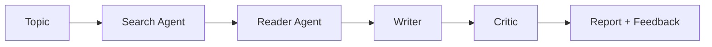

# Multi-Agent Research System

An AI research assistant built with LangChain and Gemini. Give it a topic and it searches the web, reads the best sources, writes a report, and reviews it.

**Search → Read → Write → Review**

## Architecture



| Step | Type | What it does |
|---|---|---|
| Search Agent | Agent + Tavily tool | Finds sources and returns titles and URLs |
| Reader Agent | Agent + scraping tool | Scrapes the best URLs and pulls out the key facts |
| Writer | LLM chain | Writes a structured Markdown report |
| Critic | LLM chain | Scores the report and suggests improvements |

## Tech Stack

- **Python 3.11**
- **LangChain**: agents and chains
- **Google Gemini**: LLM
- **Tavily**: web search
- **BeautifulSoup, Requests**: web scraping
- **Streamlit**: web UI

## Project Structure

```
├── app.py              # Streamlit app
├── main.py             # CLI entry point
├── requirements.txt
└── src/
    ├── agents/         # Agents and chains
    ├── pipeline/       # Runs the 4 steps
    └── tools/          # Search and scraping tools
```

## Installation

```bash
git clone https://github.com/Nehabheemreddy/Agents.git
cd Agents

conda create -n langagent python=3.11 -y
conda activate langagent

pip install -r requirements.txt
```

Create a `.env` file in the project root:

```env
GOOGLE_API_KEY=your-gemini-key
TAVILY_API_KEY=your-tavily-key
```

Get keys from [Google AI Studio](https://aistudio.google.com/apikey) and [Tavily](https://app.tavily.com).

## Usage

**Web app**
```bash
streamlit run app.py
```

**Command line**
```bash
python main.py
```

## Contributing

Pull requests are welcome. For major changes, please open an issue first.
